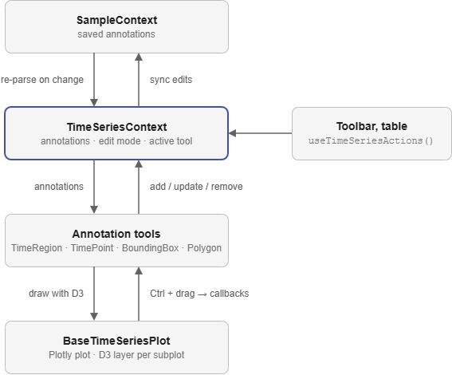

# Time Series & Profile 2D Views

The time series and profile 2D views share one plotting and annotation system. [Plotly](https://plotly.com/javascript/) draws the data, [D3](https://d3js.org/) draws the annotations on top of it, and a React context holds the annotation state. The profile 2D view is the same system with a heatmap and two extra tools.

### Why Plotly and D3?
Plotly provides zooming, panning, subplots, a range slider and heatmaps, so there is no need to build these ourselves. Every annotation tool draws its own SVG with D3 on a layer above each Plotly subplot, rather than using Plotly's shape tools. This keeps one way of building tools, gives them all the same look and feel, and lets any tool be used in any view.

Plotly captures most pointer events to drive panning and zooming, so annotations are drawn with **Ctrl** held to tell drawing apart from panning.

### Structure
```
SampleProvider                      saved annotations for the sample
├── ToolBar                         left toolbox
└── TimeSeriesView / Profile2dView
    └── TimeSeriesProvider          the view's working copy of the annotations
        ├── BaseTimeSeriesPlot      Plotly plot, D3 layers and pointer events
        │   ├── TimeRegion
        │   ├── TimePoint
        │   ├── BoundingBox         profile 2D only
        │   └── Polygon             profile 2D only
        ├── AnnotationsTable
        └── AnnotationToolbar
```

The context is in [`contexts/TimeSeriesContext.tsx`](https://github.com/ukaea/toktagger/blob/dev/toktagger/ui/src/app/contexts/TimeSeriesContext.tsx), the plot in [`components/plots/base-plot.tsx`](https://github.com/ukaea/toktagger/blob/dev/toktagger/ui/src/app/components/plots/base-plot.tsx) and the tools in [`components/tools/`](https://github.com/ukaea/toktagger/tree/dev/toktagger/ui/src/app/components/tools).

### Annotation State
There are two copies of the annotations:

* `SampleContext` holds them in the backend format (`Annotation` in `types.ts`). This is what gets saved, and it also holds annotations the view does not draw, such as shot labels.
* `TimeSeriesContext` holds them as `TimeSeriesAnnotation`: a list of `{ x, y }` points in data coordinates and a `selected` flag. A time region is two points, a time point one, a bounding box its top-left and bottom-right corners, and a polygon one point per vertex.

`utils.tsx` converts between the two. When `SampleContext` changes, the view re-parses everything. When the view changes an annotation, it syncs back 100 ms later, or once a drag has finished, replacing only the annotation types it owns.

Inside the view, change annotations through the `useTimeSeriesActions()` actions. The left toolbox sits outside `TimeSeriesProvider`, so the annotators there write to `SampleContext` directly.

!!! warning
    The `id` on a `TimeSeriesAnnotation` is regenerated every time the annotations are re-parsed. Do not store it.

### The Base Plot
`BaseTimeSeriesPlot` renders the plot with `Plotly.react`, then adds an SVG group to each subplot for the tools to draw into. It passes `plotId` and `plotReady` to each child tool.

It listens for pointer events on the plot and forwards them to the active tool. Ctrl + pointer down starts a drawing, so long as the user is in edit mode and has picked a tool. Pixel positions are converted to data coordinates with Plotly's axis transforms. After every zoom or pan it bumps `forceUpdate`, which makes the tools redraw at their new positions.

### Annotation Tools
Each tool is a component that does two things in two effects:

1. **Registers callbacks** with `registerTooling(type, callbacks)`. The base plot calls `start`, `move` and `end` as the user draws, plus the optional `hover`, `doubleClick` and `cancel`. Registering is also what adds the tool's button to the annotation toolbar.
2. **Renders with D3.** It clears what it drew last time and redraws every annotation of its type, attaching `d3.drag` handlers to move and resize them. It turns off pointer events when Ctrl is held or the view is not in edit mode.

Right-clicking an annotation opens a single shared menu, rendered by `TimeSeriesProvider`. Tools open it with `show()` from `useContextMenu`.

Each tool gives its shapes an `aria-label` (`time-zone`, `time-point`, `bounding-box`, `polygon`). The end-to-end tests find annotations by these labels.

### Profile 2D
`Profile2dView` uses the same provider, plot, toolbar and table, with a few differences:

* The heatmap is the top subplot and the integrated values the bottom one, sharing a time axis.
* `BoundingBox` and `Polygon` are limited to the heatmap with `subplot="xy2"`.
* New annotations are tagged with the selected signal through the provider's `signalName`.
* Y-axis rescaling is turned off, as the heatmap's y-axis is fixed, and the hover tooltip is hidden while drawing.

### Adding a Tool
1. Add the type to `TimeSeriesAnnotationType` in `types.ts`, and a Zod schema matching the backend's Pydantic schema.
2. Add the conversions to `utils.tsx`, and the label list to the categories in `TimeSeriesProvider`.
3. Create the component in `components/tools/`, using an existing tool such as `BoundingBox` as a template.
4. Add Box Select support in `findSelectedAnnotations`, and a marker for the annotations table.
5. Add it as a child of `BaseTimeSeriesPlot` in each view that should offer it.

### How It Fits Together

<figure markdown="span">
   
</figure>
