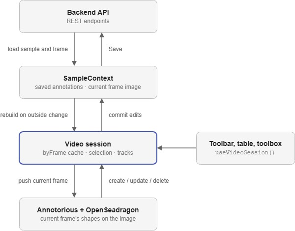

# Video View

The video view annotates camera data one frame at a time. [OpenSeadragon](https://openseadragon.github.io/) displays the frame with zooming and panning, [Annotorious](https://annotorious.dev/) draws and edits the shapes on top of it, and a React context called the video session keeps the two in step with the sample's saved annotations.

### Why Annotorious?
Annotorious provides drawing, selecting, moving and resizing shapes on an image, and works directly with OpenSeadragon's zoom and pan. The view adds what Annotorious does not have: frames, tracking an object across frames, points and frame labels.

### Structure
```
VideoUiStateProvider                    UI settings kept between samples
└── Annotorious                         the Annotorious API, read with useAnnotator()
    └── VideoSessionProvider            the video session, reset for each sample
        └── VideoNavAdapterBridge       connects Save and Clear to the session
            ├── ToolBar                 left toolbox, including VideoToolbox
            └── VideoView
                ├── FrameAnnotatorHost  OpenSeadragon viewer and Annotorious overlay
                ├── VideoAnnotationsTable
                └── VideoAnnotationToolbar
```

Unlike the time series view, the left toolbox sits inside the session, so it can use `useVideoSession()`.

The session is in [`video-session.tsx`](https://github.com/ukaea/toktagger/blob/dev/toktagger/ui/src/app/video/components/video-session.tsx), the viewer in [`frame-annotator-host.tsx`](https://github.com/ukaea/toktagger/blob/dev/toktagger/ui/src/app/video/components/frame-annotator-host.tsx), and the helpers in [`anno-utils.ts`](https://github.com/ukaea/toktagger/blob/dev/toktagger/ui/src/app/video/components/anno-utils.ts) and [`video-utils.ts`](https://github.com/ukaea/toktagger/blob/dev/toktagger/ui/src/app/video/components/video-utils.ts).

### Frames
Only the current frame is loaded. Moving to another frame sets `dataParams` on `SampleContext` to `{ name: "image", frame }`, which fetches that frame from the backend as a single image. Before the frame changes, `flushCurrentFrameOverlay()` saves whatever is drawn on the current frame into the session.

### Annotation State
The annotations exist in three places:

* `SampleContext` holds them in the backend format (`video_bounding_box`, `video_polygon`, `video_point`, `video_frame_label`). This is what gets saved.
* `byFrame` in the session maps each frame number to its annotations in the Annotorious format. It is rebuilt whenever `SampleContext` changes from outside the session, such as an import.
* Annotorious holds only the current frame's annotations.

When the user draws or edits a shape, Annotorious fires an event, and `commitFromAnnotorious` writes the frame's annotations back into `byFrame` and `SampleContext`. When the frame changes, the session pushes that frame's list from `byFrame` into Annotorious. Frame labels have no shape, so they skip `byFrame` and Annotorious and live only in `SampleContext`.

In the Annotorious format, the class label and track ID are stored as annotation bodies with the purposes `tagging` and `identifying`, and the frame is stored on `target.source`. `anno-utils.ts` converts between the two formats.

!!! tip
    Change annotations through the functions on `useVideoSession()` rather than calling the Annotorious API directly. The session needs to see every change to keep `byFrame` and `SampleContext` in step.

### Tracks and Instances
Every annotation has a track ID, such as `brave-glow-4`, which links the same object across frames. A class label and track ID together make an **instance**, which is what the annotations table lists.

The session's `selection` is the class label and track ID that the next annotation will use. Picking a class starts a new track, and selecting an existing instance continues its track on the current frame. With propagation on, pressing Next copies manual instances that are missing from the next frame.

The class labels for all four annotation types come from the project's `video_bounding_box_labels`.

### Tools
Bounding boxes and polygons use Annotorious's own drawing tools. Points and frame labels do not have Annotorious tools, so `FrameAnnotatorHost` handles their clicks itself:

* A point is stored in Annotorious as a small ellipse with a `shape: point` body. The ellipse shape comes from UKAEA's fork of `@annotorious/plugin-tools`.
* A frame label is added to, or removed from, `SampleContext` directly.

As in the other views, drawing needs edit mode with **Ctrl** held. The session exposes this as `drawIntent`, which turns on Annotorious drawing and stops clicks selecting existing shapes.

### Saving
`VideoNavAdapterBridge` provides the shared navigation controls with a `NavAdapter`. Save sends the annotations in `SampleContext`, and Clear removes the annotations on the current frame.

### How It Fits Together

<figure markdown="span">
   
</figure>
