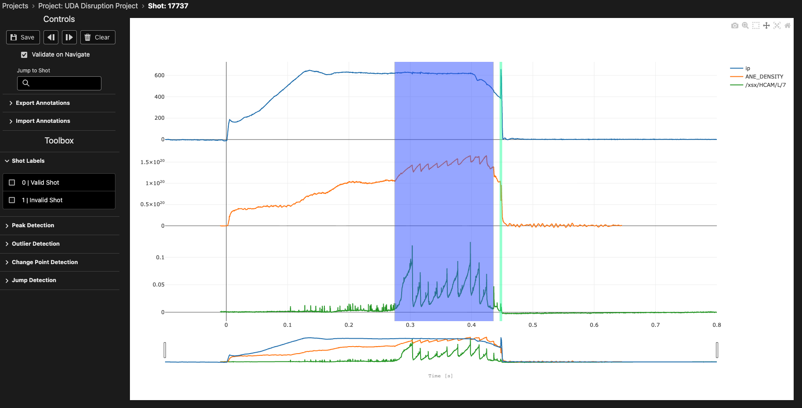

# Time Series Labelling Interface

The time series labelling interface is a core UI in TokTagger, designed for interactive labelling and analysis of multi-variate tokamak diagnostic data. This interface allows you to visualize signals, create annotations, and navigate through your dataset efficiently.

## Overview

<figure markdown="span">
   
  <figcaption>The time series labelling interface showing multi-variate time series data with annotations.</figcaption>
</figure>

The time series view displays multiple diagnostic signals stacked vertically, each with its own y-axis, sharing a common time axis. This layout enables you to visualize correlations between different signals and identify important events across multiple diagnostics simultaneously.

## Interface Components

### Plot Area

The main plot area displays your time series data as line plots. Each signal occupies its own subplot with:

- **Independent Y-axis**: Each signal has its own vertical scale, which rescales automatically to fit the data in the visible time window
- **Shared X-axis**: All signals share the same time axis at the bottom, measured in seconds
- **Range Slider**: A range slider below the time axis allows quick navigation and zooming to specific time windows

### Navigation Controls

In the top left of the interface, you'll find navigation controls to move through your dataset:

- **Annotations Validated / Not Validated**: Shows whether the annotations on this sample have been checked and saved. Saving marks the sample as validated, and Clear marks it as not validated
- **Save Button**: Save your current annotations
- **Previous Button** (◄): Navigate to the previous sample in your project
- **Next Button** (►): Navigate to the next sample in your project
- **Clear Button**: Remove **all** annotations from the current sample, and mark the sample as not validated. The annotations are removed from the database the next time you save, including through Save on Navigate
- **Save On Navigate**: Whether to automatically save any annotations to the database when you move to a different sample
- **Jump to Shot**: Jump to a sample with a given shot ID

**Keyboard Shortcuts:**

- `Shift + ←`: Navigate to previous sample
- `Shift + →`: Navigate to next sample

### Plot Toolbar

The Plotly toolbar at the top right of the plot provides navigation tools:

- **Download plot**: Export the current view as an image
- **Zoom**: Box zoom to a time window of interest
- **Box Select**: Click and drag to select multiple annotations within a region (Edit mode only)
- **Pan**: Click and drag to pan the view (the default drag mode)
- **Autoscale**: Zoom out to show all data
- **Reset axes**: Return to the initial view

### Annotation Toolbar

The annotation toolbar sits to the right of the plot and drives all annotation
creation:

1. Use the top button to switch between **edit mode** and **view mode**. Press
   `e` to toggle quickly.
2. Activate the desired tool from the list of buttons, then use the dropdown that
   appears to select the label to apply.
3. With a tool active, add annotations using **ctrl+drag** on the plot.

Annotations can only be created, selected, moved or deleted in edit mode. In view
mode you can still zoom and pan freely without accidentally changing an annotation.
Switching back to view mode clears any selection.

### Annotations Table

<figure markdown="span">
   { width="700" }
  <figcaption>The annotations table, listing each annotation on the current sample.</figcaption>
</figure>

Below the plot, the annotations table lists every annotation on the current sample. Each row shows a marker in the annotation's colour, its class label, its type (time region or time point) and who created it - `manual` for an annotation drawn by hand, or the name of the automated annotator or ML model that created it.

- **Click on a row** to move the plot to that annotation. In Edit mode, this also selects the annotation. Selecting annotations on the plot highlights their rows in the table.
- **Delete annotation** (bin icon): Delete that annotation. Deleting requires Edit mode.

### Sample Information

The interface displays the current sample ID and project information, helping you keep track of which data you're annotating.

## Creating Annotations

TokTagger supports two primary types of annotations for time series data:

### Time Regions (Zones)

Time regions are rectangular annotations that span a time interval and cover all signal values. They are ideal for labelling extended events or operational phases.

**To create a time region:**

1. Enter edit mode and activate the **TIME REGION** tool
2. Choose a label from the dropdown
3. Ctrl+drag horizontally across the plot to span the interval

**Visual appearance:** Time regions appear as semi-transparent colored rectangles spanning the full height of all subplots. The color corresponds to the category assigned.

**Available categories:** configured per project (see [Creating Projects](creating_projects.md)) - the list below is an example.

- ELM
- L-mode  
- H-mode
- Thermal Quench
- Current Quench
- Sawtooth
- IRE (Internal Reconnection Event)
- Locked Mode
- VDE (Vertical Displacement Event)
- Unknown

### Time Points (VSpans)

Time points are vertical line annotations marking specific moments in time. They are useful for identifying instantaneous events or transitions.

**To create a time point:**

1. Enter edit mode and activate the **TIME POINT** tool
2. Choose a label from the dropdown
3. Ctrl+click at the moment of interest

**Visual appearance:** Time points appear as vertical colored lines extending through all subplots.

**Available categories:** configured per project - the list below is an example.

- Disruption
- Thermal Quench
- Current Quench
- Control Loss

To abandon an annotation part way through drawing it, press `Esc`.

## Modifying Annotations

All of the actions below require edit mode.

### Selecting Annotations

- **Click** on any annotation to select it
- **Box Select**: enable the toolbar's Box Select tool, then drag a box to select multiple annotations at once
- **Click on a row** in the annotations table to select that annotation
- Selected annotations appear with increased opacity and can be modified

### Moving Annotations

- **Time Regions**: Click and drag the body of a time region to move it horizontally along the time axis
- **Time Points**: Click and drag the vertical line to reposition it

### Resizing Time Regions

Time regions have resize handles on their left and right edges:

1. Hover over the left or right edge of a time region until the cursor changes
2. Click and drag the edge to adjust the start or end time

**Minimum width:** Time regions have a minimum width of 0.1% of the current visible time range to ensure they remain visible and selectable.

### Changing Categories

To change the category of an existing annotation:

1. Right-click on the annotation to open its context menu
2. Select "Set type" and choose the new category

If you right-click on a selected annotation, the new category is applied to every selected annotation of the same type.

### Deleting Annotations

To remove an annotation, do one of the following:

- Right-click on the annotation and select "Delete" from the context menu. If the annotation is selected, every selected annotation is deleted
- Select one or more annotations and press `Delete` or `Backspace`
- Click the bin icon on the annotation's row in the annotations table

## Plot Interaction

### Zooming and Panning

The time series plot supports interactive zooming and panning:

- **Pan**: Click and drag on the plot background to pan horizontally
- **Zoom**: Use the mouse wheel, the toolbar's Zoom tool, or the range slider at the bottom to zoom into specific time windows
- **Reset**: Double-click on the plot to reset the view to show all data

**Note:** Only the time axis zooms. Each y-axis rescales automatically to fit the data in the visible time window.

## Working with Multiple Signals

The time series interface automatically arranges multiple diagnostic signals in a stacked layout:

- Each signal occupies an equal vertical space
- Signals are synchronized along the time axis
- Annotations span across all signals, making it easy to see temporal relationships

Common multi-signal workflows:

1. **Identifying correlations**: Look for simultaneous changes across different diagnostics
2. **Event detection**: Use one signal to identify events (e.g., D-alpha for ELMs) and verify with others
3. **Phase labelling**: Label operational phases visible across multiple diagnostics

## Automated Annotation Tools

For faster annotation, use the automated [annotators](annotators.md) to detect patterns in your signals:

- **Peak Detection**: Identify sharp peaks in signals (useful for ELMs)
- **Change Point Detection**: Detect transitions between operational phases
- **Jump Detection**: Find discontinuities (useful for sawteeth)
- **Outlier Detection**: Identify anomalous data points

See the [Annotators guide](annotators.md) for detailed information on each tool.
