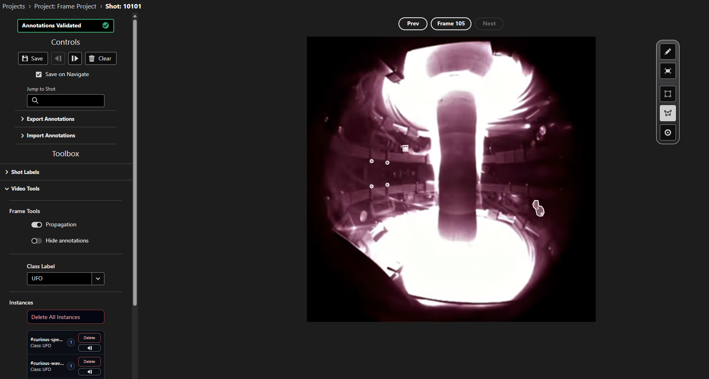

# Video Labelling Interface

The video labelling interface is designed for annotating video data with points, bounding boxes, polygons or frame labels. This interface allows you to visualize camera data from a Tokamak, create annotations, and navigate through frames & samples efficiently.

## Overview

<figure markdown="span">
   
  <figcaption>The video labelling interface showing a bounding box annotation on MAST camera data, with the annotations table below.</figcaption>
</figure>

For a given sample, the video UI allows you to cycle through different frames of the video, and make annotations. Annotations can be automatically propagated between adjacent frames, for the tracking of transient phenomena.

The interface supports four types of annotations:

- **Bounding Box**: A rectangular box, whose position, height and width are recorded.
- **Polygon**: An abstract, closed shape made up of multiple points. The position of each point is recorded.
- **Point**: Single point annotations, with no size attached. The coordinates of the point are recorded.
- **Frame Label**: A label for the whole frame, with no shape attached. Use it to tag a frame in which something of interest is happening.

The interface has two modes. You can move around your image and inspect existing annotations in View mode, and create / edit annotations in Edit mode.

## Interface Components

### Frame Controls
At the top of the interface, the frame which you are currently viewing is shown. You can step through different frames of camera data for the current sample:

- **Previous Button**: Move to the previous frame, if available
- **Next Button**: Move to the next frame, if available
- **Jump to Frame**: Click on the frame number, and then enter a frame number which you would like to jump to, if available.

### Annotation Toolbar
On the right hand side of the image, the annotation toolbar controls the mode which you are in, and the type of annotation you wish to create. From top to bottom, the buttons control:

- **Mode**: The mode which you are in, either View (default) or Edit. Click the button, or press `e`, to switch between them.
- **Bounding Box**: Select the bounding box annotation type, which will be used when you next create an annotation.
- **Polygon**: Select the polygon annotation type.
- **Point**: Select the point annotation type.
- **Frame Label**: Select the frame label annotation type.
- **Reset View**: Reset the image to the default zoom level, and centre the image within the window.

The annotation tools can only be selected in Edit mode.

### Navigation Controls

In the top left of the interface, you'll find navigation controls to move through your dataset:

- **Annotations Validated / Not Validated**: Shows whether the annotations on this sample have been checked and saved. Saving marks the sample as validated, and Clear marks it as not validated
- **Save Button**: Save your current annotations
- **Previous Button** (◄): Navigate to the previous sample in your project
- **Next Button** (►): Navigate to the next sample in your project
- **Clear Button**: Remove all annotations from the **current frame**, and mark the sample as not validated. The annotations are removed from the database the next time you save, including through Save on Navigate. To remove annotations from every frame, use **Delete all** in the annotations table
- **Save On Navigate**: Whether to automatically save any annotations to the database when you move to a different sample
- **Jump to Shot**: Jump to a sample with a given shot ID

### Video Tools
In the left toolbar, you'll find a Video Tools collapsible section. This section contains:

- **Propagation toggle**: In Edit mode, when enabled, pressing **Next** appends manual annotations whose class and track instance is missing from the following frame, even if that frame already contains annotations. Model-created annotations are not propagated, and existing destination instances are not overwritten. The switch is disabled in View mode.

When reviewing completed annotations, remain in View mode whenever you do not intend to make changes. If you need to review in Edit mode, turn Propagation off before moving through frames to prevent missing manual instances from being added again unintentionally.

- **Hide Annotations toggle**: Allows you to temporarily hide annotations from the image - useful to see the image underneath an annotation to check if it is accurate.
- **Class label**: The label to associate with the next annotation that is drawn. This can also be changed by right clicking on an empty part of the image and selecting a new label from the menu.

#### Annotations Table
Below the frame, the annotations table lists one row per instance (a class label and track ID), sorted by the frame it first appears in. Use the **All Frames / This Frame** toggle above the table to list every instance, or only those present in the current frame. The columns are the annotation's marker, class label, type, track ID, first frame and who created it.

<figure markdown="span">
   { width="700" }
  <figcaption>All Frames: every instance in the sample, sorted by the frame it first appears in.</figcaption>
</figure>

<figure markdown="span">
   { width="700" }
  <figcaption>This Frame: only the instances present in the current frame.</figcaption>
</figure>

- **Click on a row** to select that instance and highlight it on the image, if it is present in the current frame. This also switches to that instance's annotation tool. If the selected instance is not present on the current frame, drawing while it is selected adds a new annotation to this frame with the same track ID. Choosing a different tool starts a new track instead. Click the row again to deselect it.
- **Jump to annotation** (rewind icon): Jump to the first frame where the instance is present, and select it there.
- **Delete annotation** (bin icon): In All Frames, delete the instance across all frames where it is present. In This Frame, delete it from the current frame only.
- **Delete all**: In All Frames, delete all annotations across all frames. In This Frame, delete all annotations on the current frame.

Deleting requires Edit mode, and asks for confirmation unless you are deleting a single instance from the current frame.

**Keyboard Shortcuts:**

- `e`: Switch between View and Edit mode
- `Hold Ctrl`: Draw with the selected tool (Edit mode only)
- `Shift + ←`: Navigate to previous sample
- `Shift + →`: Navigate to next sample

## Create Annotations

### View Mode
By default you are in View mode, where you can:

- Click and drag on the image to move it
- Use the scroll wheel to zoom in/out of the image
- Select an annotation to view information about it
- Reset the position / zoom of the image by pressing the **Reset View** button at the bottom of the annotation toolbar.

### Edit Mode
You can enter Edit mode by clicking the **View Mode** button at the top of the annotation toolbar, or by pressing `e`. Within Edit mode, select an annotation type from the annotation toolbar, then **hold Ctrl** while you draw. You can still zoom and pan the image in Edit mode when Ctrl is not held.

* **Bounding Box**: Hold Ctrl, then click and drag to draw a rectangular box.
* **Polygon**: Hold Ctrl, then click and drag to draw a line between the first two points in the polygon, and release to place the point. Then click in the next location to place the next point. Finish the polygon by clicking back on the first point you placed.
* **Point**: Hold Ctrl and click on the image to place a point. These have no size component attached to them - the coordinates of the centre of the dot is recorded as a point.
* **Frame Label**: Hold Ctrl and click anywhere on the image to tag the whole frame with the selected class label. Ctrl+click again with the same class label to remove the tag. Frame labels appear as badges to the left of the image.

## Edit Annotations
To edit an existing annotation, make sure that you are in Edit mode, and then select an instance of an annotation on the image. This should open a popup which gives information about that annotation. From there, you can click and drag on the annotation to move its position. You can also edit the size or shape of some types of annotation:

- **Bounding Box**: Click and drag on the corners of the box to resize it.
- **Polygon**: Click and drag on any of the points which make up the polygon to change the shape of the polygon.

## Delete Annotations
To delete a single instance of an annotation in a specific frame, click on that annotation and then press the 'Delete' button in the popup which appears. For a frame label, click on its badge to open the popup.

To delete all instances of an annotation, or to delete all instances of all annotations, use the annotations table below the frame.

## Import / Export Annotations
In the left hand toolbar, there are dropdowns which allow you to either import or export sets of annotations from the selected sample. 

If importing annotations, upload a JSON file with a set of annotations which correspond to the schemas expected for video data (`VideoBoundingBox`, `VideoPolygon`, `VideoPoint` or `VideoFrameLabel`, [find their definitions here.](https://github.com/ukaea/toktagger/blob/dev/toktagger/api/schemas/annotations.py)). 

If exporting annotations, a JSON file containing all of the annotations in the above schema formats will be downloaded to your computer. You can choose whether to export all annotations for all samples within your project, or just from the current sample.
